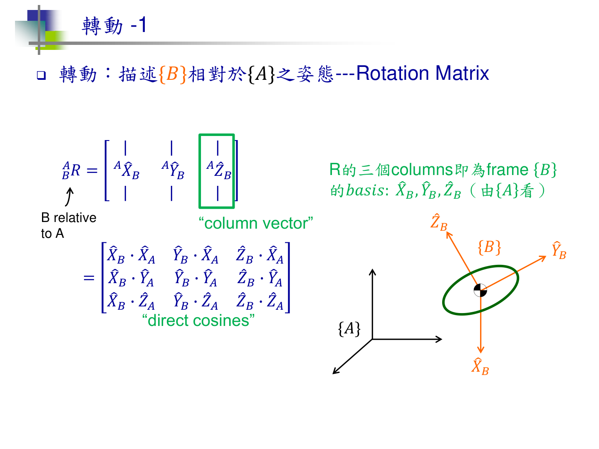
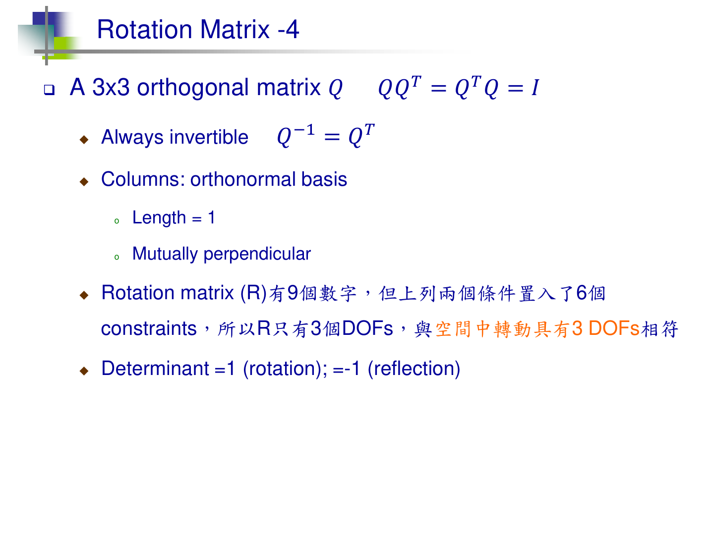
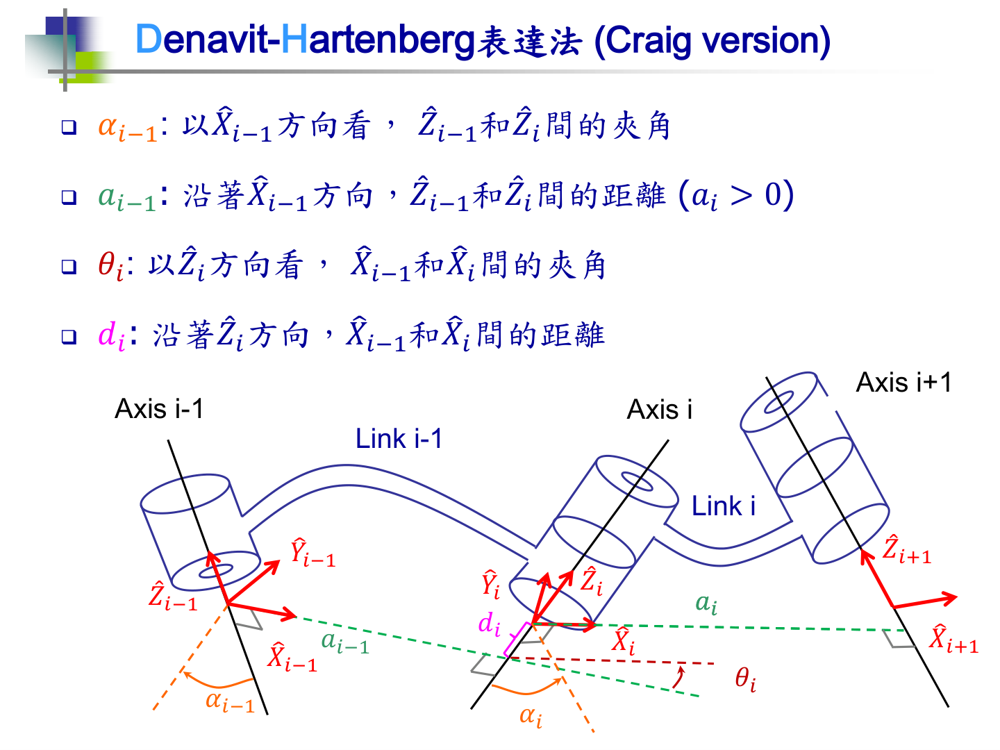
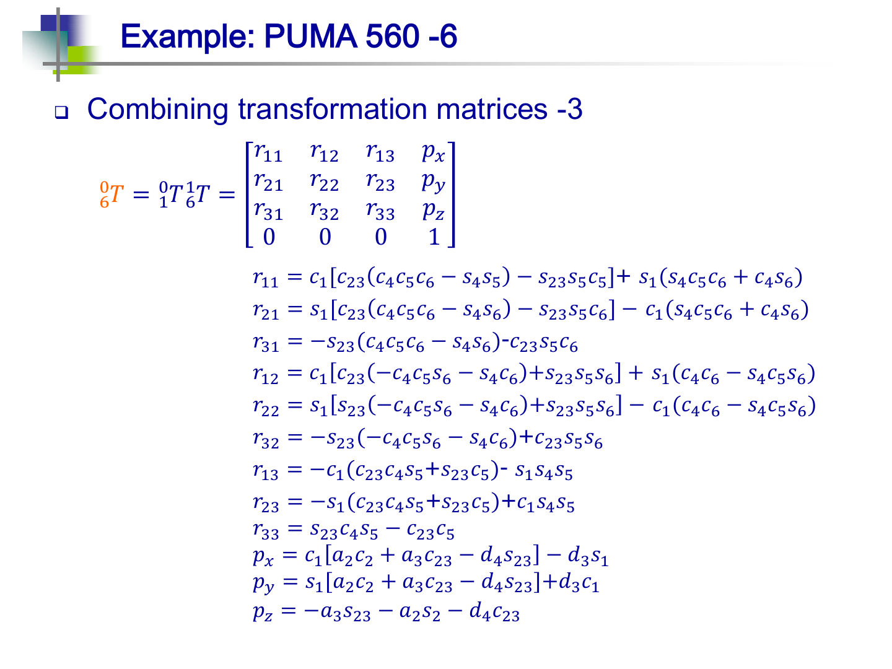
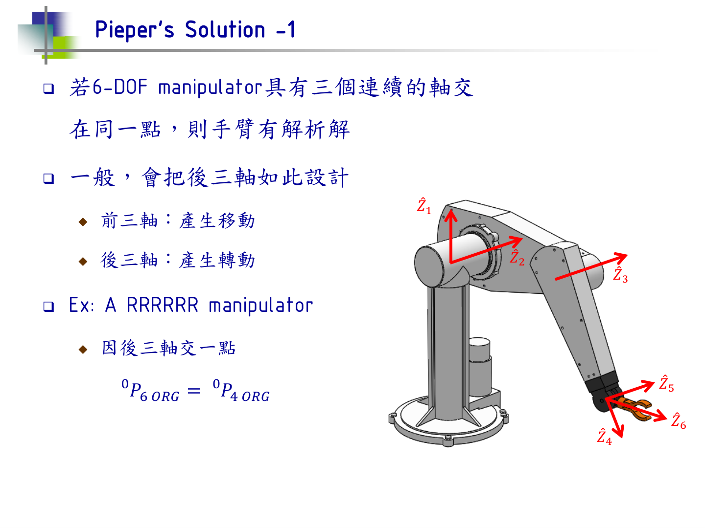
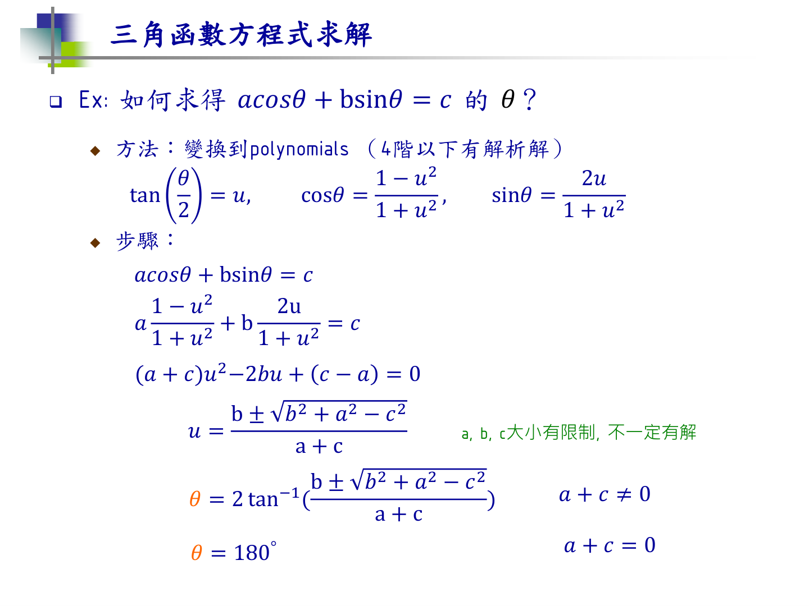
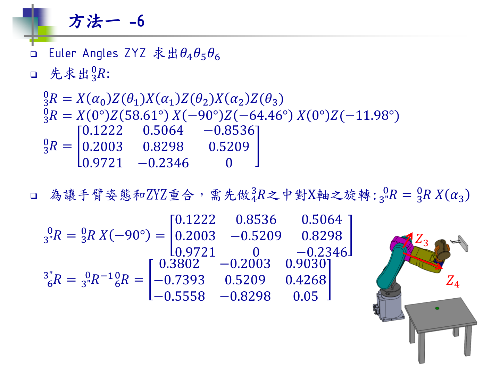
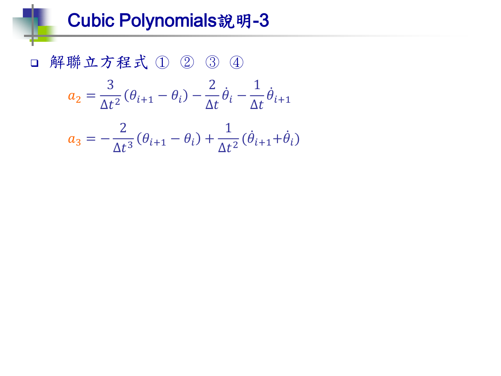
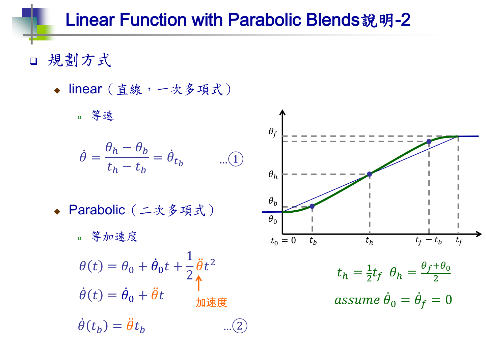
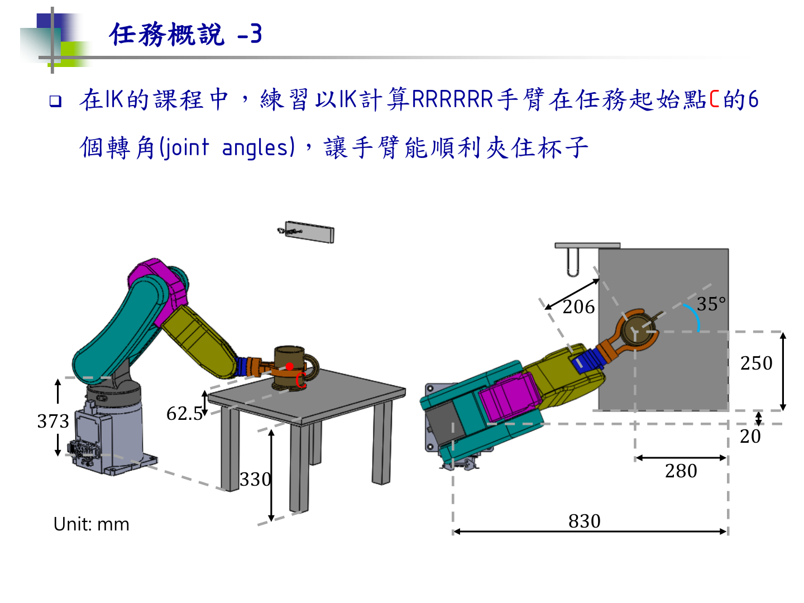

# 机器人运动学学习汇报

> **汇报人**：张宇涵　·　**日期**：2026-11-03（周二）·　**时长**：约 30 分钟
> **课程**：台大 林沛群《機器人學（一）》· B站 `BV1v4411H7ez`
> **规模**：7 讲 / 54 分P / 视频 **10 小时 35 分** / 课件 **212 页**
> **产出**：4 个练习文件（全部跑通 + 闭环验证）、2 份笔记、GitHub 仓库

---

# 一、一句话结论

**把机械臂"从几何到运动"这条链走通了：旋转矩阵 → DH 建模 → 正解（末端在哪）→ 逆解（每个关节转多少）→ 轨迹规划（怎么走）。**

配套代码**完整复现了课件的逆解结果**（`58.61 / −64.46 / −11.98 / 25.30 / −87.13 / −56.19`），并用正运动学回代做闭环验证。

**一句话的缺口**：这套课**没有雅可比**，所以"速度层"和"奇异位形"还是空的，那是下一步。

---

# 二、课程覆盖了什么

| 讲 | 主题 | 核心内容 | 时长 |
| :---: | :--- | :--- | ---: |
| 0 | 导论 | 机器人学在做什么 | 13:14 |
| 1 | 剛體運動狀態描述 | 移动 / 转动 / **旋转矩阵** | 57:44 |
| 2 | Rotation Matrix 與轉角 | Fixed/Euler 角、**齐次变换**、Mapping vs Operator | 1:29:11 |
| 3 | 順向運動學 | 手臂几何、**DH 参数**、PUMA 560 | 1:42:22 |
| 4 | 逆向運動學 | 多解、解析法、**Pieper 解法** | 1:40:32 |
| 5 | 軌跡規劃引言 | Joint/Cartesian 空间、**三次多项式** | 1:38:20 |
| 6 | LSPB | 直线 + 抛物线过渡 | 1:35:39 |
| 7 | 軌跡規劃實例 | 取放任务（Capstone） | 1:18:00 |

**整套 10 小时 35 分，课件 212 页。**

**学习方式**：每讲先看视频 → 再对着课件精读 → 最后写代码验证。三个动作缺一不可，光看视频记不住，光写代码没有物理直觉。

---

# 三、五个核心技术点

## 3.1　旋转矩阵：列 = 基向量



**这一页是整门课的地基。**

我记不住 `sin/cos` 表，但记住"**第 j 列 = 第 j 根轴转完之后指向哪**"之后，三个基本旋转矩阵都能现场推出来：

```text
绕 z 转 90°： e₁ → +y，e₂ → −x，e₃ → 不动

           ⎡ 0  −1   0 ⎤
Rz(90°) =  ⎢ 1   0   0 ⎥        ← 三列就是三个去向
           ⎣ 0   0   1 ⎦
```

**验证**：`Rz(90°)·Rz(90°) = Rz(180°)` —— 矩阵相乘 = 转动叠加。这一条是后面齐次变换串联的全部原理。

## 3.2　三条性质：9 个数为什么只剩 3 个自由度



课件这句是精髓：**"9 个数字，两个条件塞进 6 个 constraints，所以 R 只有 3 个 DOFs"**。

| 性质 | 数学 | 物理 |
| :--- | :--- | :--- |
| 正交 | `RᵀR = I` → `R⁻¹ = Rᵀ` | 三列互相垂直、长度 1 |
| 行列式 | `det = +1` | 旋转；`det = −1` 是**镜像** |
| 自由度 | 9 − 3（长度）− 3（垂直）= 3 | 与空间转动 3 DOF 吻合 |

**实测数据**：

```text
RᵀR − I 的最大偏差 = 2.8e-17      （机器精度的 0）
det(R)             = 1.000000
```

**踩过的坑**：拿课件上的 `0.866` 手算验 `det`，会得到 `0.999956` —— 因为 `0.866² = 0.749956 ≠ 0.75`。**这不是矩阵错了，是四舍五入。**

## 3.3　DH 参数：四个数描述相邻连杆



**四个参数是两两配对的**：

| 参数 | 绕 / 沿 | 量什么 | 量纲 |
| :--- | :--- | :--- | :--- |
| `α_{i-1}` | 绕 `x_{i-1}` | 两根 z 轴的夹角 | 角度 |
| `a_{i-1}` | 沿 `x_{i-1}` | 两根 z 轴的距离 | 长度 |
| `θ_i` | 绕 `z_i` | 两根 x 轴的夹角 | 角度 |
| `d_i` | 沿 `z_i` | 两根 x 轴的距离 | 长度 |

**两级变换（Craig 版）**：

```text
T_{i-1}^{i} = Rx(α_{i-1}) · Dx(a_{i-1}) · Rz(θ_i) · Dz(d_i)
```

**我踩过的坑**：把 `α` 当成"距离"。实际上一对平行轴 `α = 0` 但 `a ≠ 0` —— 夹角为零，距离还在。这两个字母长得像，量纲完全不同。

**另一套约定**：Standard DH 的乘积顺序是 `Rz·Dz·Dx·Rx`，和 Craig 正好反。**两套不能混用**，混了整个矩阵错位。

## 3.4　正运动学：连乘到末端

```text
T₀⁶ = T₀¹ · T₁² · T₂³ · T₃⁴ · T₄⁵ · T₅⁶
```

**物理含义**：矩阵从右往左作用到点上（`p₀ = T₀¹(T₁²(…p₆))`），所以**先转的写在最右边**。



这是 PUMA 560 的最终展开式 —— **12 个姿态元素 + 3 个位置元素，全都变成关节角的三角函数**。

**这张图想说明的是**：正解的"结果"就是一坨这样的式子。手工展开不现实，所以必须靠矩阵连乘 + 程序。

**我的验证**（2 连杆平面臂）：

```text
DH 连乘得到的末端位置 [1.0731, 1.2727]
解析式 l₁cos q₁ + l₂cos(q₁+q₂) = [1.0731, 1.2727]     ✅ 一致
```

## 3.5　逆运动学：三步走



**Pieper 解法的前提**：三根轴交于一点 → 位置和姿态可以解耦 → 存在解析解。

### 关键工具：三角方程



`a·cosθ + b·sinθ = c` 这个方程在逆解里到处出现。课件用**半角替换**把它化成二次方程：

```text
u = tan(θ/2) → cosθ = (1−u²)/(1+u²), sinθ = 2u/(1+u²)
→ (a+c)u² − 2bu + (c−a) = 0
→ u = [b ± √(b²+a²−c²)] / (a+c)
```

**判别式 `b²+a²−c² < 0` 就是"够不着"** —— 这是逆解无解的判据。

### 具体三步（以这台 RRRRRR 手臂为例）

```text
① θ₁ = atan2(Y, X)                        ← 三维问题降到竖直平面
② 两式平方相加，消掉 θ₂₃
   → 一个只含 θ₃ 的三角方程 → 解出 θ₃（两支）
③ 回代 → 2×2 线性方程 → 解出 θ₂
```

**"平方相加"为什么能消元**：两个方程的交叉项里，`c₂c₂₃ + s₂s₂₃ = cos θ₃`、`s₂c₂₃ − c₂s₂₃ = −sin θ₃` —— 用和角公式化简后，`θ₂` 被吃掉了。

### 手腕单独解（ZYZ）



前三个关节定了之后，把姿态矩阵"除掉"前三个关节的影响，剩下的就是纯手腕：

```text
⁰₃R = Rz(θ₁)·Rx(−90°)·Rz(θ₂+θ₃)
⁶₃"R = Rx(90°)·(⁰₃R)ᵀ·⁰₆R        ← 摘出纯手腕姿态
ZYZ 反解 → θ₄ = α,  θ₅ = −β,  θ₆ = γ
```

**实测复现**（课件 P₂ 点）：

```text
课件：58.61,  −64.46,  −11.98,  25.30,  −87.13,  −56.19
我算：58.61,  −64.46,  −11.98,  25.30,  −87.13,  −56.19     ✅ 一字不差
```

**多解**：`θ₃` 两支（肘上/肘下）× 腕部 `β` 正负 = 4 组解。工程上按**关节限位 + 离上一时刻最近**来选。

## 3.6　轨迹规划：cubic vs LSPB



**三次多项式**：4 个系数 ← 4 个边界条件（起止位置 + 起止速度）。解出来的系数就是图上这两个式子。



**LSPB**（直线 + 抛物线过渡）：位置是"抛物线-直线-抛物线"，**速度是梯形**。

| | 三次多项式 | LSPB |
| :--- | :--- | :--- |
| 位置 | 三次 | 二次 + 一次 |
| 速度 | 二次 | **梯形** |
| 加速度 | **线性（连续）** | **阶跃（不连续）** |
| 路径 | 光滑曲线 | 直线 + 圆角 |
| 电机 | 持续变力矩 | **恒力矩段，好实现** |
| 典型 | 需要平滑的运动 | 搬运、点到点（工业主流） |

**LSPB 的代价**：加速度在交界处跳变 → jerk 无穷大 → 有冲击。更高级的做法是 S 曲线（加加速度连续）。

---

# 四、完整案例：取放任务



任务：手臂从桌上夹起杯子，挂到墙上的杯架。

| 步骤 | 内容 |
| :---: | :--- |
| 1 | 从几何图算出 4 个关键点的位姿 `⁰₆T` |
| 2 | 每个点跑一次 IK → 4 组关节角 |
| 3 | 在关节空间用 LSPB 插值 |
| 4 | 正解回验末端轨迹 |

**方法一 vs 方法二**：

```text
方法一（Cartesian space）：在末端空间规划 → 每个采样点都要 IK
方法二（Joint space）    ：先 IK 出 4 个关键点 → 在关节空间插值 → IK 只跑 4 次
```

一条 2 秒的轨迹按 1 kHz 采样：**方法二要 2000 次 IK，方法二只要 4 次。差 500 倍。**

---

# 五、代码与验证

| 文件 | 内容 | 验证结果 |
| :--- | :--- | :--- |
| `01_旋转矩阵与坐标变换.py` | 列规则、三个基本矩阵 | 三个 `det = +1`，`RᵀR−I` 偏差 `0` |
| `02_旋转角与齐次变换.py` | Fixed/Euler、齐次变换求逆 | `T·T⁻¹` 偏差 `1.1e-16` |
| `03_DH参数.py` | DH 表、连乘、Craig vs Standard | 四组 DH vs 解析式全 `OK` |
| `04_逆运动学.py` | 三角方程、2 连杆逆解 | 闭环 5/5 `True` |

**GitHub**：https://github.com/zhangyuhan265-rgb/robot-kinematics

---

# 六、踩过的坑（这部分能说明真的动手了）

| # | 坑 | 怎么发现的 |
| :---: | :--- | :--- |
| 1 | `α` 当成距离 | 平行轴时 `α=0` 但 `a≠0`，表格对不上 |
| 2 | 用 `0.866` 验 `det` 得 `0.999956` | 手算和代码对不上，查回四舍五入 |
| 3 | `Ry` 的负号位置 | 三个基本矩阵里只有它不一样 |
| 4 | DH 的 `Rx` 是 3×3，`Tx` 是 4×4，直接相乘崩溃 | 运行报 `matmul` 维度错 |
| 5 | 逆解里 `q1` 和 `q2` 写了同一个式子 | 闭环验证 `含原解: False` |
| 6 | 逆解 `+180` 补错了分支 | FK 回代发现末端不对 |
| 7 | `c23` 以为是 `cosθ₂·cosθ₃` | 展开矩阵才看出是 `cos(θ₂+θ₃)` |
| 8 | 平方相加移项忘了变号 | 解出 `168°` 而不是 `−12°` |

**共同点**：全是"没验证就下结论"。所以后面每个结论都配了验证 —— **`det`、闭环、FK 回代、和课件数字对账**。

---

# 七、30 分钟讲法

| 时间 | 讲什么 | 配合 |
| :---: | :--- | :--- |
| 0:00–1:00 | **一句话结论**：这条链走通了；缺口是雅可比 | — |
| 1:00–3:00 | 课程地图：7 讲、10.5 小时、212 页 | 第二节表 |
| 3:00–8:00 | **旋转矩阵**：列 = 基向量 + 三条性质（9−6=3） | 3.1 / 3.2 图 |
| 8:00–13:00 | **DH**：四参数、α vs a 的坑、两套约定 | 3.3 图 |
| 13:00–16:00 | **正解**：连乘 + PUMA 展开式（说明为什么要写程序） | 3.4 图 |
| 16:00–23:00 | **逆解**：三步 + 三角方程 + ZYZ；现场给复现的数字 | 3.5 三图 |
| 23:00–26:00 | **轨迹规划**：cubic vs LSPB 对比表 | 3.6 两图 |
| 26:00–28:00 | 案例 + 代码验证 + 踩坑清单 | 第四、五、六节 |
| 28:00–30:00 | **缺口与下一步** | 第九节 |

**只需要 10 分钟时**：砍掉 13:00–16:00 和 26:00–28:00，只讲"旋转矩阵 → DH → 逆解三步 → 缺口"。

---

# 八、导师可能问的问题（预案）

**Q1：DH 为什么有两套约定？**
> Craig 版把 `x` 放在两轴公垂线上、`z` 沿关节轴；Standard 版顺序相反。同一台机械臂两套表都能写，但**乘积顺序不同**（Craig 是 `Rx·Dx·Rz·Dz`，Standard 是 `Rz·Dz·Dx·Rx`）。混用会让整个矩阵错位。

**Q2：逆解为什么会有多解？**
> 三个来源：肘部构型（`θ₃` 的 ±）、腕部翻转（`θ₅` 的 ±）、以及 `θ₁` 的 ±180°。工程上按**关节限位**和**离上一时刻最近**来选，保证轨迹连续。

**Q3：雅可比是什么，为什么重要？**
> `ẋ = J(q)·q̇`，把关节速度映射到末端速度。`det J = 0` 的位置是**奇异位形**（比如手腕伸直），那里某个方向动不了。轨迹规划里要避开它，轨迹优化里 `J(q)` 是核心约束。**这套课没讲，是我下一步要补的。**

**Q4：LSPB 和三次多项式怎么选？**
> 要求末端**走直线**（焊、涂、切）用 LSPB；要求**加速度连续**（怕振动）用三次或更高阶。LSPB 的加速度在交界处跳变，会有冲击。

**Q5：这些都验证过吗？**
> 每个结论都配了验证：`det`、`RᵀR−I`、`T·T⁻¹`、DH vs 解析式、逆解闭环、以及和课件数字逐位对账。踩过的 8 个坑就是这么发现的。

---

# 九、不足与下一步

## 缺口

| 缺什么 | 影响 | 计划 |
| :--- | :--- | :--- |
| **没有雅可比** | 轨迹优化的 `J(q)` 是黑盒；奇异位形、速度层映射做不了 | 从 Craig 教材补第 5 章 |
| 没有动力学 | 只到运动学层，还没到力矩 | 本轮不碰 |
| 没接触真实机械臂 | 全是数值验证 | 后续接 ROS / MoveIt |

## 与本方向的关系

```text
运动学（已学完）
    ↓
轨迹规划（已学：cubic / LSPB）
    ↓
时间最优 / 冲击最优 / 避障      ← 下一步
    ↓
需要 J(q)                        ← 当前缺口
```

**结论：运动学的地基打完了，下一步补雅可比 + 进优化层。**

---

*2026-11-01 整理*
